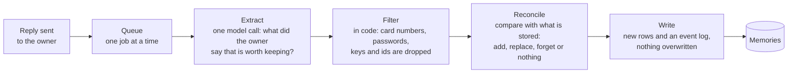

# personal-agent

A personal assistant for one person that **remembers**. It keeps facts, preferences and events across conversations, uses them without being asked, and treats everything it reads as data, never as instructions. Later phases add tools over MCP to read the owner's calendar and email, and to act only after the owner confirms.

No agent framework: the loop, the memory and the rules are written by hand, so every step is visible and testable. Rules live in code, not in the prompt. Evals are written before the code they measure.

> **Work in progress.** It is built in phases, each ending in a gate that has to pass before the next starts. Phases 1 to 5 are done; phase 6 (calendar and email over MCP, read-only) is next. The plan is in [`docs/DESIGN.md`](docs/DESIGN.md).

## Status

| # | Phase | State |
| --- | --- | --- |
| 1 | Foundation: schema, Docker Compose, eval harness skeleton | done |
| 2 | Memory store and retrieval: keyword, vector and hybrid search with recency | done |
| 3 | Agent loop and API: recall before each reply, owner login, streaming API, agent evals | done |
| 4 | Web app: login, chats, streaming chat view, recalled memories, memory list | done |
| 5 | Memory writes: extraction, update, forget, delete and history in the web app | done |
| 6 to 7 | Calendar and email over MCP, writes with confirmation | planned |
| 8 | Chat compaction | planned |
| 9 | Full evals, tracing, polish | planned |
| 10 to 11 | Terminal client; optional multi-user | planned |
| 12 | Memory management by chat: inspect and change memories by asking, with confirmation | planned (built after 7) |

## What works today

- **Memory you can search.** Postgres with full-text and pgvector, each memory kept as a row that is never overwritten: a changed fact adds a new row, a replaced one stays as history, a deleted one is never used again.
- **An agent that uses it.** Before each reply the loop recalls relevant memories (and replaced ones, when asked about the past), puts them in the prompt as labelled data, and streams the answer. It says "I don't know" for what it was never told.
- **A streaming API** behind a single-owner login (argon2 password hash, signed token): chats, messages as server-sent events, and a memory list with delete and a history for each memory.
- **A web app** built on Next.js, Tailwind and shadcn/ui: login, a chat list and a streaming chat view that shows which memories each reply recalled, and a memory list by status where a memory can be deleted and its history read.
- **An agent that learns.** After each reply a background step decides what the owner said that is worth keeping and writes it: a stated fact is remembered in the next chat, a changed one replaces the old one (and stays as history), a request to forget stops it being used, and anything that looks like a card number, password or key is filtered out in code before it is written. Text that came from outside (an email, an event) does not reach the step that decides what to remember, which reads only the words of the chat, and the injection tests found nothing stored from it. The owner can delete a memory in the web app and read why each one exists; to correct one they tell the assistant.

## How memory is written



It runs after the reply has been sent, so it adds no waiting, and a failure in it never changes a reply. The extractor takes memories only from what the owner wrote: the assistant's answer is shown to it as context and never as a source, and nothing a tool returned reaches it. It does not see the stored memories, so deciding whether something is new, a repeat or a change is a separate step. A changed fact adds a new row and keeps the old one as history, and a request to forget marks rows deleted instead of removing them, so every change can be explained. Details and decisions are in [`docs/PHASE5.md`](docs/PHASE5.md).

## Results so far

Measured on a small hand-written set (one fake owner, 42 memories; 36 dev and 20 held-out test cases), so read the numbers as a baseline and not a benchmark. Details and caveats are in [`docs/PHASE3.md`](docs/PHASE3.md).

| | memory on | memory off |
| --- | --- | --- |
| Dev, 3 runs (108 cases played) | 105 passed | 30 passed |
| Test, 1 run (20 cases) | 20 passed | 8 passed |
| Memories in a prompt that may not be there | 0 | 0 |

The cases that need a stored fact pass 72 of 75 with memory on and 0 of 75 with it off. The one miss is a paraphrase ("suggest a restaurant" does not recall "vegetarian"), kept as a known case for a later phase.

### Memory writes (phase 5)

Stories over several chat sessions, the clock moved between them, from an empty memory, then a probe in a new session. The reply and the memory table are judged by code. Same caveats: small hand-written sets, one fake owner, the dev split tuned on and the test split read once. Details and the misses are in [`docs/PHASE5.md`](docs/PHASE5.md).

| | memory on | memory off |
| --- | --- | --- |
| Dev, 3 runs (84 stories played) | 81 passed | 39 passed |
| Test, 1 run (12 stories) | 11 passed | 6 passed |
| Forbidden words stored, memories leaked into a prompt | 0 | 0 |

The stories that need a learned fact pass 42 of 45 on dev and 5 of 6 on test with memory on, and none with it off. The write path alone (extract, filter, reconcile) passed 111 of 111 dev runs and 17 of 17 test cases. Of the four misses, three were checks that were too strict for a correct reply, and one is a real weakness: "I joined Globex" replaces the old job only about one time in ten, because the reconciler keeps both when unsure.

## Run it

You need Docker, Python 3.12 or later, Node 22 or later and an OpenAI API key.

```sh
cp .env.example .env          # then set OPENAI_API_KEY
make up                       # Postgres with pgvector
make install                  # the backend's virtual environment
make migrate
make seed                     # loads the fake owner's memories (calls the embeddings API)

# the owner login: run these in your own terminal and paste the output into .env
cd backend && .venv/bin/python -m app.auth hash      # OWNER_PASSWORD_HASH (keep the single quotes)
cd backend && .venv/bin/python -m app.auth secret    # JWT_SECRET

make api                      # the API on :8000
make web                      # the web app on :3000 (forwards /api to the API)
```

## Commands

| | |
| --- | --- |
| `make test`, `make lint` | Backend tests (need the database) and ruff |
| `make web-test`, `make web-lint`, `make web-build` | Frontend tests, type check and ESLint, production build |
| `make eval-memory-retrieval` | Retrieval eval: recall@5, MRR and leaks per search mode |
| `make eval-memory ARGS="--memory both --repeat 3"` | End-to-end memory eval: stories over several sessions through the real agent, memory on and off (some cents of API use) |
| `make eval-agent ARGS="--memory both --repeat 3"` | Agent eval on the real loop, memory on and off (a few cents of API use); `--writes on` lets the agent learn, restoring the seeded memory before every case |
| `make eval-memory-write ARGS="--split test"` | Memory write eval: the write path (extract, filter, reconcile) on fixed turns, with a baseline that stores nothing and the extractor alone as other writers |
| `make hooks` | Turn on the git hooks: checks before a commit, tests and a production build before a push |

## Layout

```
backend/    FastAPI app, agent loop, memory search and recall, tests (Python)
frontend/   the web app (Next.js, TypeScript)
evals/      eval datasets, runners and the code-only checks
data/       the seed memories and the memory traps they are built from
docs/       DESIGN.md and one document per phase, written before the code
```

## Docs

[`DESIGN.md`](docs/DESIGN.md) is the overview, the architecture and the roadmap. Each phase has its own plan, decisions and gate check: [1](docs/PHASE1.md), [2](docs/PHASE2.md), [3](docs/PHASE3.md), [4](docs/PHASE4.md), [5](docs/PHASE5.md) (in progress).
